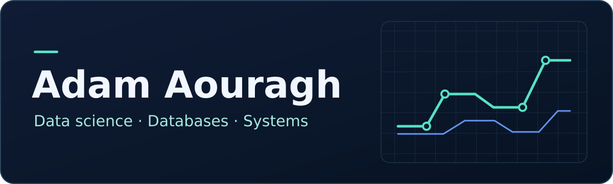

## About me

I'm a university student in Morocco interested in data science. I'm building my foundation in SQL, Linux, and computer networking through hands-on coursework. I'm looking for a data science internship where I can learn from a team and contribute to real projects.

## What I’m working on

| Area | What I’m practicing |
| --- | --- |
| Databases | Writing SQL queries and designing tables with keys and constraints in Oracle APEX |
| Linux and systems | Working in Ubuntu and learning how processes communicate |
| Computer networks | Inspecting Ethernet frames and packet captures in Wireshark |

## Connect

[LinkedIn](https://www.linkedin.com/in/adam-aouragh/) · [GitHub repositories](https://github.com/aouraghadam70-gif?tab=repositories)
